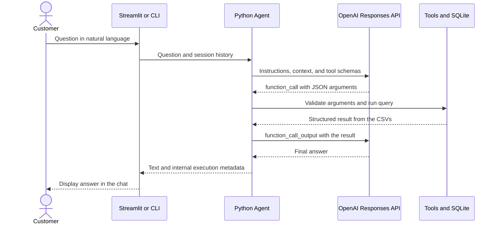
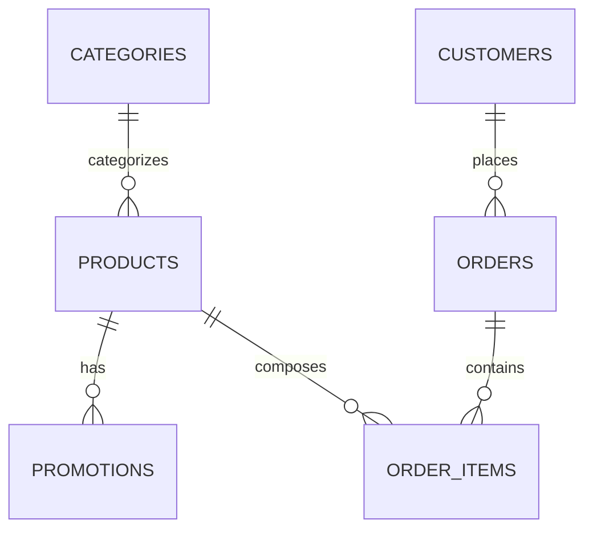

# Empório da Música — customer service agent with OpenAI and CSVs

A Python application that answers questions about musical instruments, prices,
promotions, availability, and orders. The chat interface runs locally with
Streamlit. Message interpretation and response writing use the OpenAI
Responses API; operational queries use **exclusively the six challenge CSVs**.

The idea is to separate natural language, data access, and calculations: the model
identifies the customer's need and requests tools, while the code validates the
arguments, runs SQL queries, and computes prices. The customer receives a direct
answer, with no file names or references to internal sources.

## Table of contents

- [Running the project](#running-the-project)
- [Service scope](#service-scope)
- [Architecture and the flow of a question](#architecture-and-the-flow-of-a-question)
- [Data organization and validation](#data-organization-and-validation)
- [How product search works](#how-product-search-works)
- [How prices and promotions are calculated](#how-prices-and-promotions-are-calculated)
- [How an order is looked up](#how-an-order-is-looked-up)
- [Implemented optimizations and their limits](#implemented-optimizations-and-their-limits)
- [Tools, prompt, and agent limits](#tools-prompt-and-agent-limits)
- [History and resource lifecycle](#history-and-resource-lifecycle)
- [Configuration and troubleshooting](#configuration-and-troubleshooting)
- [Project structure](#project-structure)
- [Validation and conversations with the real model](#validation-and-conversations-with-the-real-model)
- [Limitations and next steps](#limitations-and-next-steps)
- [AI usage and delivery](#ai-usage-and-delivery)

## Running the project

### Requirements

- Python 3.11 or higher.
- `uv`, or Python with `pip` and a virtual environment.
- Internet access to install dependencies and reach OpenAI.
- An `OPENAI_API_KEY`, access to the configured model, and available credits/quota.
- The six CSVs in the `data/` folder or in `EMPORIO_DATA_DIR`.

### Installing with uv

Run the commands from the project root:

```bash
uv sync --frozen --extra dev
cp -n .env.example .env
```

`cp -n` preserves an existing `.env`. Edit that file and fill in the key:

```dotenv
OPENAI_API_KEY=your_api_key
OPENAI_MODEL=gpt-5-mini
```

The value above is only a configuration placeholder; use your real key in the
local file and keep `.env` out of Git. The code reads the key on the server side
and never displays it in the interface.

Validate the data and start the chat:

```bash
uv run emporio check
uv run streamlit run interface_chat_streamlit.py
```

Open [http://127.0.0.1:8501](http://127.0.0.1:8501), type your question in the
bottom field, and press Enter. **New conversation** clears the session context.
The server listens only on `127.0.0.1`; Ctrl+C in the terminal stops it.
Without a configured key, the question field is disabled.

`uv sync --frozen` uses the versions resolved in `uv.lock`. The `dev` extra adds
the local validation tools. The `check` command verifies the CSVs without calling
OpenAI and can be used before setting up billing.

### Alternative with pip

```bash
python3 -m venv .venv
source .venv/bin/activate
python -m pip install -e '.[dev]'
streamlit run interface_chat_streamlit.py
```

On PowerShell, activation is `.venv\Scripts\Activate.ps1`. The `pip` installation
respects the version ranges in `pyproject.toml`; it does not apply the uv lockfile.

### Terminal interface

```bash
uv run emporio chat
uv run emporio chat --message 'How much does the Ohana CK-20 cost?'
uv run emporio chat --trace --message 'Which available acoustic guitars cost up to R$ 1000?'
uv run emporio chat --session atendimento_01
```

In the interactive conversation, `/sair` exits and `/limpar` erases the session's
logical history. `--message` answers a single question and exits. `--session`
allows resuming the history across runs. `--trace` writes to stderr the tool
names, the success/error result, and the duration of each execution.

There is no demo mode or alternative provider. An API failure is reported to the
user, without generating a canned response to replace the model.

## Service scope

| Topic | How the system handles it |
| --- | --- |
| Products and categories | Searches names, descriptions, specifications, and category |
| Availability | Checks product status and stock quantity |
| Prices and promotions | Uses list price and the promotion identified as active |
| Orders | Verifies number and e-mail before returning status, items, and tracking |
| Delivery estimate | Presents the recorded estimate, without treating it as confirmed receipt |
| Missing information | Directs the customer to confirm with the team |

The CSVs contain no general policies on PIX, interest, installments, shipping,
exchanges, returns, or warranty, nor the store's address, contact details, or
opening hours. This data is not filled in with the model's general knowledge or
with information from earlier answers. For example, an old order paid in six
installments does not prove that any new purchase can be split interest-free.

The original PDFs remain as challenge materials. The application **does not open,
index, or query PDFs**, and the rules previously extracted from them have been removed.

## Architecture and the flow of a question



The diagram shows a simple query. The model may request other tools before
writing the answer, within the round and call limits.

1. **The interface receives the message.** In Streamlit, `st.chat_input` receives
   the question and `st.chat_message` renders the messages. Input accepts up to
   4,000 characters. The presentation layer escapes the BRL currency symbol to
   prevent Markdown from interpreting it as a formula.
2. **The service prepares the conversation.** It loads the configuration, creates
   the OpenAI client, loads the CSVs into SQLite, and rebuilds the session's
   recent history.
3. **The agent sends the context.** The request contains the service
   instructions, the date in `America/Campo_Grande`, the history, and the tool
   schemas. The first round requires a tool call.
4. **The model chooses a tool.** The response indicates the function name and its
   JSON arguments. Pydantic validates types, required fields, limits, and extra
   fields before execution.
5. **Python runs the query.** The SQL statements are defined in the code. The
   model fills in the filters and identifiers accepted by the tools.
6. **The result goes back to the model.** The agent sends `function_call_output`,
   linked to the call by `call_id`. The model uses that data to compose the answer.
7. **The conversation is updated.** A complete answer, preceded by a query, is
   saved to the agent's history. The interface displays it and the service closes
   its resources in `finally`.

If the API response is incomplete, no query is made, or all tools fail, the agent
stops the flow with a message saying it cannot confirm the information. This
control checks the query flow; the fidelity of each sentence to the result still
depends on the model and must be evaluated.

### Technical choices

| Choice | Reason |
| --- | --- |
| Python | Main language required by the challenge and well suited to integrating the components |
| Streamlit | Local chat with native components and per-session state |
| OpenAI Responses API | Message interpretation and tool calls with structured arguments |
| In-memory SQLite | Relational queries, reference validation, and execution without an external database server |
| Pydantic | Explicit contract for the arguments sent by the model |
| Custom agent loop | Direct control over limits, errors, history, and tool results |
| Structured queries | The available data is tabular and allows deterministic filters and relationships |

The default model is `gpt-5-mini`, configurable through the environment. The
choice is a starting point, with no claim of better cost, latency, or quality
based on benchmarks. The adapter follows the
[official function calling flow](https://developers.openai.com/api/docs/guides/function-calling).

## Data organization and validation

The files keep the `desafio_tecnico_ai_eng - ` prefix. The repository looks for
exactly one file for each expected suffix, such as `products.csv`. A missing file,
or more than one candidate for the same suffix, stops initialization.

| CSV | Records provided | Fields and usage |
| --- | ---: | --- |
| `categories.csv` | 9 | Category and description |
| `products.csv` | 65 | Identifier, category, description, price, stock, status, and JSON specifications |
| `customers.csv` | 50 | Identifier and e-mail for order verification |
| `orders.csv` | 20 | Buyer, date, status, total, payment, tracking, estimate, and notes |
| `order_items.csv` | 22 | Relationship between order, product, and quantity |
| `promotions.csv` | 25 | Product, percentage, description, and active-promotion flag |

The counts describe the files provided and change if the CSVs are modified.
There are four active promotion records in this initial set.



The relationships are loaded into SQLite with primary and foreign keys.
Identifiers such as `product_id` and `category_id` become `id` in their respective
internal tables; the relationship columns keep the reference.

During import, the system:

- Reads CSV with `csv.DictReader`, `utf-8-sig` encoding, and row handling by the
  CSV module, including descriptions with commas and quotes.
- Converts IDs and quantities to integers, monetary values to cents, and dates to
  formats accepted by `date.fromisoformat`.
- Checks uniqueness and references with SQLite constraints; for example, a
  product must point to an existing category.
- Requires non-negative price and stock, positive item quantity, a percentage
  between 0 and 100, and a promotion flag equal to 0 or 1.
- Validates the expected product and order states and requires `specs` to be a
  JSON object.
- Converts empty optional order fields, such as tracking and estimate, to `None`,
  so that absence does not turn into invented information.

The internal customers table keeps only ID and e-mail. Name, phone, and city
present in the original file are not needed for the implemented verification.

### Updating the CSVs

Before accessing the database, the repository checks a signature made of the path,
`st_mtime_ns`, and size of the six files. If the signature has not changed, the
instance reuses its in-memory database. If it has, the instance builds another
database, imports and validates all tables, and only then replaces the previous
connection. After import, `PRAGMA query_only=ON` puts that connection in
read-only mode.

An invalid reload raises an error and does not silently return stale data. The
metadata check avoids re-reading the contents when the instance is already loaded,
but it is not a hash: a change that preserves size and timestamp may go
undetected. Reading the six files is also not a transactional snapshot of the
file system; simultaneous updates would require another mechanism.

## How product search works

OpenAI turns a question into structured filters. For a search for nylon-string
guitars up to R$ 1,000, a possible call is:

```json
{
  "query": "nylon",
  "category": "Violões",
  "max_price_brl": 1000,
  "only_available": true,
  "limit": 5
}
```

The free text sent to the tool should contain the product terms. Budget, category,
and availability have their own fields. The search flow is:

1. Normalize case and accents with `casefold` and Unicode NFKD.
2. Split the query into alphanumeric terms.
3. Build parameterized conditions for the presence of those terms.
4. Apply the category and availability filters in SQL.
5. Query the promotions for each product found and compute its price.
6. Apply the price ceiling to the already computed value, in cents.
7. Sort by price and, on ties, by product ID.
8. Return up to `limit` products, along with `total_found` and `has_more`.

The reduced form of the query for a single term is:

```sql
SELECT p.*, c.name AS category
FROM products AS p
JOIN categories AS c ON c.id = p.category_id
WHERE instr(
    normalize(p.name || ' ' || c.name || ' ' || p.description || ' ' || p.specs),
    ?
) > 0
  AND p.status = 'active'
  AND p.stock > 0;
```

With more terms, the code adds one condition for each and combines them with
`AND`. The terms may occur in different fields of the same product. The category
is compared by presence of normalized text, also with a parameter.

User values enter through `?` placeholders. Table identifiers are constants in
the code. `instr` performs substring search; `%` and `_` do not act as SQL
wildcards in this query.

This is a textual search by terms and substrings, with no semantic ranking or
automatic typo correction. The model may reformulate a query, but the repository
does not implement approximate similarity search.

The schema accepts `limit` between 1 and 10; the prompt instructs presenting at
most five options to the customer. **The result limit is applied in Python**,
after the search, calculations, and sorting. It limits the context returned to the
model and does not work as an early `LIMIT` in the SQL execution. There is no
offset pagination.

## How prices and promotions are calculated

Prices are imported as integer cents. The discount calculation uses `Decimal` and
`ROUND_HALF_UP`, avoiding direct floating-point arithmetic for money. The BRL
display is built from the cents.

| Situation | Behavior |
| --- | --- |
| Active product with stock | Can be offered for purchase |
| Sold-out, discontinued, or upcoming product | The query reports the condition; the quote does not confirm a sale |
| No active promotion | Keeps the list price |
| One active promotion and product available | Applies the percentage recorded in the CSV |
| More than one active promotion for the available product | Returns the list price and `price_confirmed=false`; requires team confirmation |

The unit calculation is:

```text
price in cents = round(list price in cents × (100 − discount) / 100)
```

In the provided data set, the Ohana CK-20 has a list price of R$ 549.00 and one
active 20% promotion, resulting in R$ 439.20. This is an example derived from the
CSVs; changing those records changes the result. No additional PIX discount is
assumed.

With simultaneous promotions, the system does not pick an offer or stack
percentages without an available rule. The offer details remain in the internal
result, and the agent must request confirmation of the final amount.

`get_quote` receives only `product_id`. The `total` field of that result
corresponds to the **quoted unit price**: it does not represent a cart, shipping,
item quantity, or an order total. `payment_conditions` and `shipping_cost` return
`None`. The total of a historical order is read from `orders.csv`, without
recalculating with current prices.

## How an order is looked up

The lookup requires the order number and the e-mail used for the purchase:

1. The model collects the missing information in the conversation.
2. Pydantic verifies the e-mail format and the positive order identifier.
3. The tool checks that the e-mail appeared in one of the customer's own messages.
4. SQL looks for the order associated with the same e-mail, normalized with
   `strip` and `casefold`.
5. A second query relates the order's items to the product names.

```sql
SELECT o.*
FROM orders AS o
JOIN customers AS c ON c.id = o.customer_id
WHERE o.id = ? AND c.email = ?;
```

A nonexistent number and a mismatched e-mail receive the same message, reducing
simple order enumeration. The result includes status, historical total, payment,
items, tracking, estimate, and notes, and omits the buyer's name, phone, e-mail,
and ID. The application does not query the carrier or modify the order.

**Knowing an e-mail is not strong authentication.** This mechanism suits the
prototype with the challenge's fictitious data. A public service would require
authentication and per-customer authorization, for example with an authenticated
session or OTP. The e-mail the customer writes stays in the context sent to
OpenAI; minimizing the result avoids sending the entire record, without
eliminating this necessary transmission.

## Implemented optimizations and their limits

The current strategy concentrates deterministic work in Python/SQLite and reduces
the volume of data sent to the model. The initial set has 65 products, and the
implementation prioritizes clarity, low infrastructure cost, and controlled
queries. No latency, concurrency, or maximum-capacity benchmark is published.

| Existing mechanism | Benefit and reach |
| --- | --- |
| Query before sending data to the LLM | Sends relevant results instead of putting all six CSVs in the prompt |
| In-memory SQLite | Avoids an external database service and allows joining tables in the same instance |
| Text, category, and stock filters in SQL | Reduces the candidates that move on to price calculation in Python |
| Integer primary keys | Allow locating a product or order by ID without scanning those tables |
| Metadata signature | Avoids re-importing when the same `Catalog` instance already holds the current files |
| Limited results and limited history | Controls part of the growth of the context sent to the API |
| Monetary calculation in code | Keeps rounding and pricing deterministic for the queried data |
| Single-order lookup | Avoids sending the customer list and all orders to the model |
| Round and call limits | Prevent a question from generating an unbounded query loop |

### Reuse: terminal and Streamlit behave differently

| Execution | Lifetime of the operation's database |
| --- | --- |
| Interactive CLI | One `Catalog` instance lives for the whole run; later queries can reuse it |
| Streamlit | Each question creates a new instance and imports the six CSVs; the tools for that question share that instance |

In the web chat, creating resources per question avoids sharing a SQLite
connection across Streamlit threads and sessions. This simplifies isolation, at
the cost of re-importing on every message. **There is no global catalog cache
across questions or users**, nor any use of `st.cache_data` or
`st.cache_resource`. The file signature helps within each instance's lifetime,
and does not eliminate the initial import for the next question in Streamlit.

### What still costs work in search

The text search computes `normalize` and `instr` at query time. There is no text
index, FTS, or functional index for that expression: it scans the products.
In addition, `_product` queries promotions separately for each candidate. That is
one main query plus N promotion queries for N candidate products, before the final
list is cut. The metadata check also happens on accesses to the `db` property.

The price ceiling and sorting stay in Python because they depend on the price
after promotion analysis. This decision is simple for the current base, but it
still requires processing all candidates returned by the SQL query.

In local inspection with `EXPLAIN QUERY PLAN`, the by-ID queries used
`SEARCH ... USING INTEGER PRIMARY KEY`; the text search showed `SCAN p`, and the
promotions query showed `SCAN promotions`. There is no explicit secondary index
on `promotions(product_id, active)` in this version.

To check these plans without calling OpenAI:

```bash
uv run python - <<'PYTHON'
from emporio.configuracoes_da_aplicacao import Settings
from emporio.repositorio_catalogo_e_pedidos import Catalog

catalog = Catalog(Settings.load().data_dir)
try:
    queries = [
        ("SELECT id FROM products WHERE id=?", (121,)),
        ("SELECT discount FROM promotions WHERE product_id=? AND active=1", (121,)),
        ("SELECT id FROM products WHERE instr(normalize(name),?)>0", ("takamine",)),
    ]
    for sql, params in queries:
        print(sql)
        for row in catalog.db.execute("EXPLAIN QUERY PLAN " + sql, params):
            print(" ", row[3])
finally:
    catalog.close()
PYTHON
```

Improvements for a larger base would be fetching promotions in batch or by
aggregation, creating indexes after measuring the plans, evaluating FTS,
computing filters/sorting in the database, and introducing a per-file-version
cache with isolated connections. These improvements **are not implemented**; they
are next steps to measure.

## Tools, prompt, and agent limits

| Tool | Arguments | Main result |
| --- | --- | --- |
| `search_products` | `query`, `category`, `max_price_brl`, `only_available`, `limit` | Filtered products, total count, and an indication of more results |
| `get_quote` | `product_id` | Unit price, promotion, and need for confirmation |
| `get_order` | `order_id`, `customer_email` | A single order after identity verification |
| `get_available_information` | Empty object `{}` | Categories and limits of the available information |

The schemas generated by Pydantic are sent as function calling tools with
`strict=true`. The application also validates the received arguments: extra
fields are rejected, prices cannot be negative or non-finite, and result-count
limits are checked before accessing the repository.

The prompt defines the persona, per-turn queries, answers without citing sources,
and human confirmation of missing information. Tool results and descriptions are
treated as data, with no authority to override instructions. These guidelines
reduce the risks of hallucination and prompt injection, but do not constitute
proof of absolute security or fidelity of the model.

| Control | Current configuration |
| --- | --- |
| Message length | 1 to 4,000 characters in the agent |
| Rounds per question | Default 6; configurable from 1 to 12 |
| Tool calls | Up to 12 in total and up to 4 in a single model response |
| Parallelism requested from the API | `parallel_tool_calls=false` |
| Output per API call | `max_output_tokens=4000` |
| SDK timeout | 30 seconds per call |
| Automatic retries | Disabled |
| History used by the agent | Up to 40 messages, equivalent to 20 completed interactions |

A question normally needs one API call to choose the tool and another to write the
answer. A search followed by a quote may require one more call. The timeout is an
HTTP client setting; there is no global timer for the entire question. Network
operations and successive rounds can lead to a total wait longer than 30 seconds.
The limits help control usage, without being a monetary ceiling per conversation.
The 40-message limit applies between turns; the results of that question's tools
also enter the context while the agent runs its rounds.

## History and resource lifecycle

### Web interface

`st.session_state` stores displayed messages and the history of completed
interactions. The service opens a temporary SQLite history, restores the recent
messages, runs the agent, returns the updated history, and closes the database,
history, and OpenAI client in `finally`.

Failure messages may appear in the chat but are not saved as a completed
interaction in the history sent to the agent. **New conversation** erases both
lists. The web session is not written to disk and may be lost when the browser
session ends or is recreated.

### Terminal

Without `--session`, the history is also kept in memory. With `--session`, it is
saved in `.state/history.sqlite3`, separated by identifier. The history table has
an explicit index on `(session, id)` to retrieve the session's recent messages.
Identifiers accept 1 to 64 letters, digits, `_`, or `-`.

`/limpar` removes the current session's rows. This does not promise to erase
copies in backups or to forensically wipe the old bytes. The file has no
application-level encryption and no automatic time-based expiration.

### What stays in the context and logs

The persisted history contains only the customer's text and the final answer.
Tool results and arguments are resent to the model during the turn, but are not
persisted as conversation history between turns. The trace contains only the tool,
success/error, and tool duration; it does not measure the total latency of the
question or record token usage or cost.

The API is called with `store=false`, and the application manages the history
locally. This is not equivalent to a general guarantee of no operational retention
by the provider. Avoid unnecessary personal data and do not share a single session
between different customers.

## Configuration and troubleshooting

| Variable | Default | Usage |
| --- | --- | --- |
| `OPENAI_API_KEY` | empty | Key required for service |
| `OPENAI_MODEL` | `gpt-5-mini` | Model compatible with the Responses API and function calling |
| `EMPORIO_DATA_DIR` | `data` | Folder with the six CSVs |
| `EMPORIO_STATE_DIR` | `.state` | Directory for the CLI's persistent history |
| `EMPORIO_MAX_ROUNDS` | `6` | Round limit, from 1 to 12 |

The configuration uses the current folder if it contains `data/`; otherwise, it
uses the checkout root obtained from the installed package. The `.env` in that
root is read without overriding variables already present in the environment.
Relative data and state paths are resolved from that root; you can also pass:

```bash
uv run emporio --data-dir /path/to/data check
```

Prefer running from the project root. The wheel distribution contains the Python
package but does not embed the CSVs: they must accompany the installation.

| Situation | What to check |
| --- | --- |
| `Port 8501 is not available` | An instance may already be running; open the existing chat or stop it before starting another |
| Question field disabled | Set `OPENAI_API_KEY` in `.env` or the environment |
| Changed key has no effect | Restart Streamlit and check whether an environment variable takes precedence |
| Missing or ambiguous CSV | There must be exactly one file per expected suffix |
| Invalid CSV | Check headers, types, IDs, references, dates, and the specifications JSON |
| `credit_balance_exhausted` | Check the balance of the organization linked to the key and fix billing |
| Spending or usage limit | Check the reported code and the project/organization limits |
| Temporary rate limit | Wait for the indicated interval and reduce the call frequency |
| Network failure or timeout | Check the connection and try again |

The code prioritizes `error.code` to distinguish a lack of balance from a
temporary rate limit. It does not automatically retry requests or change the
account's billing. References:
[OpenAI errors](https://developers.openai.com/api/docs/guides/error-codes)
and [API billing](https://platform.openai.com/settings/organization/billing/overview).

## Project structure

| File | Responsibility |
| --- | --- |
| [interface_chat_streamlit.py](interface_chat_streamlit.py) | Visual components, session state, and message presentation |
| [servico_de_conversa_da_interface.py](src/emporio/servico_de_conversa_da_interface.py) | Assembly and closing of resources for each web question |
| [agente_de_atendimento.py](src/emporio/agente_de_atendimento.py) | Call loop, history, limits, and response |
| [repositorio_catalogo_e_pedidos.py](src/emporio/repositorio_catalogo_e_pedidos.py) | Import, validation, SQL queries, prices, and promotions |
| [ferramentas_de_consulta.py](src/emporio/ferramentas_de_consulta.py) | Pydantic schemas and dispatch of the permitted tools |
| [integracao_modelo_openai.py](src/emporio/integracao_modelo_openai.py) | Responses API adapter and error handling |
| [historico_de_conversas.py](src/emporio/historico_de_conversas.py) | Temporary or per-session persistent SQLite history |
| [instrucoes_do_agente.py](src/emporio/instrucoes_do_agente.py) | Persona and instructions for queries, scope, and presentation |
| [configuracoes_da_aplicacao.py](src/emporio/configuracoes_da_aplicacao.py) | Environment, paths, and model configuration |
| [interface_linha_de_comando.py](src/emporio/interface_linha_de_comando.py) | Validation and terminal conversation commands |
| [utilitarios_texto_e_moeda.py](src/emporio/utilitarios_texto_e_moeda.py) | Normalization, tokenization, and currency formatting |
| [avaliar_atendimento_com_modelo_real.py](scripts/avaliar_atendimento_com_modelo_real.py) | Generation and basic evaluation of conversations using the real API |
| [RELATORIO_DE_VALIDACAO_LOCAL.md](RELATORIO_DE_VALIDACAO_LOCAL.md) | Evidence from the local checks |

`pyproject.toml` defines the package, dependencies, and commands. `uv.lock` pins
the resolved versions. `.streamlit/config.toml` defines address, port, and theme,
and disables Streamlit's usage statistics. `.env.example` contains only the names
and defaults of the settings.

## Validation and conversations with the real model

Checks that do not run inference:

```bash
uv run emporio check
uv run ruff check .
uv run ruff format --check .
```

The local report records 54 passing tests covering import, reload, prices,
ambiguous promotions, CSV queries, agent limits, SDK contract, privacy, and
interface behavior. Some cases run with a folder containing only CSVs and ignore
invalid PDF/JSON files in the data folder.

**The files in `tests/` exist only on the computer**, ignored by Git, removed
from the publishable history, and excluded from the distribution, per the author's
decision. In the local checkout that contains this folder, run
`uv run pytest -q`. A clone of the public repository does not contain these files.
The public CI, on Python 3.11 and 3.12 on Linux, runs data validation, lint, and
formatting. The matrix configuration exists, but the remote run has yet to happen.

Only in the local tests, the SDK's HTTP transport is isolated to test the flow
without consuming the user's key. These tests do not measure linguistic quality,
latency, real cost, or the fidelity of a model in production.

To generate five conversations with the real OpenAI:

```bash
# Requires valid model access and credits; may incur charges.
uv run python scripts/avaliar_atendimento_com_modelo_real.py --output-dir examples
```

The scenarios cover catalog, price, promotion, order, and unavailable information.
The script checks the tools and some expected snippets of the answer, saves the
completed conversations, and produces `results.json` with scenario, a `passed`
boolean, and the tools used. The terminal shows `PASS`/`REVIEW`. Without
`--output-dir`, results go to `.state/live/`. If the agent does not complete an
answer, execution stops without fabricating a conversation.

These checks are an initial rule-based evaluation, not a benchmark or a human
evaluation of the answers. Review the conversations before delivery. The
`examples/` folder contains instructions; the five conversations must be
generated with the API working. The last real diagnostic recorded in the report
was `credit_balance_exhausted`, and does not demonstrate successful model answers.

## Limitations and next steps

The prototype does not create purchases, reservations, cancellations, refunds, or
tickets, nor does it send external messages. It also has no carrier lookup,
shipping calculation, or policies beyond the available fields. The database is a
local snapshot of the operation, and the answers depend on the CSVs and on the
model's interpretation.

Next steps, kept separate from what already exists:

1. Measure import, SQL, calculation, API, and total response time; record tokens,
   cost, and latency percentiles before choosing optimizations.
2. Reduce per-product promotion queries, evaluate indexes and database-side
   filters, and add pagination compatible with catalog growth.
3. Evaluate a per-file-version cache in the web flow, preserving connection
   isolation and correct invalidation when the data changes.
4. Adopt strong authentication, per-customer authorization, and history retention
   and protection.
5. Evaluate real answers for fidelity to the data, privacy, injection attempts,
   and handling of missing information.
6. Integrate real store systems and add streaming, as needed.

## AI usage and delivery

I used **OpenAI Codex** to analyze the challenge, structure the application,
implement the modules, write and run the local tests, and review the
documentation. The current version uses only the CSVs for queries and OpenAI for
the service.

Git records the implementation stages. The tests were removed from the publishable
history and remain local. There was no publication to GitHub, no e-mail sent, no
billing change, and no generation of fictitious conversations to replace the API.
To publish after review, set up an empty repository in your account:

```bash
git remote add origin https://github.com/YOUR_USERNAME/YOUR_REPOSITORY.git
git push -u origin main
```

Check whether the challenge materials may be included in the public repository and
keep `.env`, `.state`, and credentials out of the publication. Respect the
delivery date and time given in the selection process; the e-mail and this
deadline are not in the CSVs.