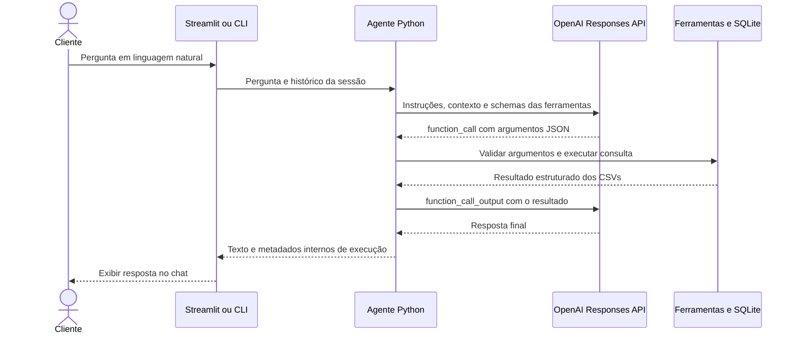
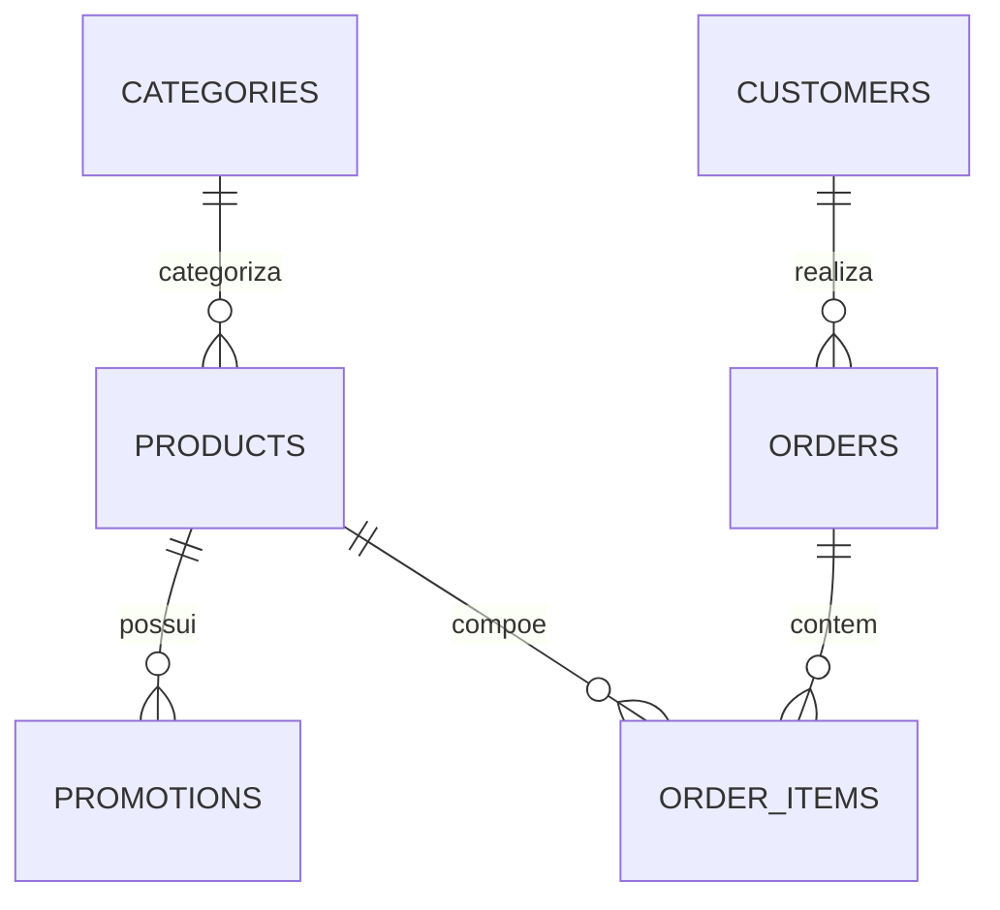

# Empório da Música — agente de atendimento com OpenAI e CSVs

Aplicação Python que atende perguntas sobre instrumentos musicais, preços,
promoções, disponibilidade e pedidos. A interface de chat roda localmente com
Streamlit. A interpretação das mensagens e a redação das respostas usam a OpenAI
Responses API; as consultas da operação usam **exclusivamente os seis CSVs do desafio**.

A proposta é separar linguagem natural, acesso aos dados e cálculos: o modelo
identifica a necessidade do cliente e solicita ferramentas, enquanto o código
valida os argumentos, executa consultas SQL e calcula preços. O cliente recebe
uma resposta direta, sem nomes de arquivos ou referências às fontes internas.

## Sumário

- [Executar o projeto](#executar-o-projeto)
- [Escopo do atendimento](#escopo-do-atendimento)
- [Arquitetura e fluxo de uma pergunta](#arquitetura-e-fluxo-de-uma-pergunta)
- [Organização e validação dos dados](#organização-e-validação-dos-dados)
- [Como a busca de produtos funciona](#como-a-busca-de-produtos-funciona)
- [Como preços e promoções são calculados](#como-preços-e-promoções-são-calculados)
- [Como um pedido é consultado](#como-um-pedido-é-consultado)
- [Otimizações implementadas e seus limites](#otimizações-implementadas-e-seus-limites)
- [Ferramentas, prompt e limites do agente](#ferramentas-prompt-e-limites-do-agente)
- [Histórico e ciclo de vida dos recursos](#histórico-e-ciclo-de-vida-dos-recursos)
- [Configuração e solução de problemas](#configuração-e-solução-de-problemas)
- [Estrutura do projeto](#estrutura-do-projeto)
- [Validação e conversas com o modelo real](#validação-e-conversas-com-o-modelo-real)
- [Limitações e evolução](#limitações-e-evolução)
- [Uso de IA e entrega](#uso-de-ia-e-entrega)

## Executar o projeto

### Requisitos

- Python 3.11 ou superior.
- `uv`, ou Python com `pip` e ambiente virtual.
- Internet para instalar dependências e acessar a OpenAI.
- Chave `OPENAI_API_KEY`, acesso ao modelo configurado e créditos/cota disponíveis.
- Os seis CSVs na pasta `data/` ou em `EMPORIO_DATA_DIR`.

### Instalação com uv

Execute os comandos na raiz do projeto:

```bash
uv sync --frozen --extra dev
cp -n .env.example .env
```

O `cp -n` preserva um `.env` existente. Edite esse arquivo e preencha a chave:

```dotenv
OPENAI_API_KEY=sua_chave_da_api
OPENAI_MODEL=gpt-5-mini
```

O valor acima é apenas um marcador de configuração; use sua chave real no arquivo
local e mantenha `.env` fora do Git. O código lê a chave no servidor e não a exibe
na interface.

Valide os dados e inicie o chat:

```bash
uv run emporio check
uv run streamlit run interface_chat_streamlit.py
```

Abra [http://127.0.0.1:8501](http://127.0.0.1:8501), escreva a pergunta no campo
inferior e pressione Enter. **Nova conversa** limpa o contexto da sessão.
O servidor escuta apenas em `127.0.0.1`; Ctrl+C no terminal encerra a execução.
Sem chave configurada, o campo de pergunta fica bloqueado.

`uv sync --frozen` utiliza as versões resolvidas em `uv.lock`. O extra `dev`
acrescenta as ferramentas locais de validação. O comando `check` verifica os
CSVs sem chamar a OpenAI e pode ser usado antes de configurar o faturamento.

### Alternativa com pip

```bash
python3 -m venv .venv
source .venv/bin/activate
python -m pip install -e '.[dev]'
streamlit run interface_chat_streamlit.py
```

No PowerShell, a ativação é `.venv\Scripts\Activate.ps1`. A instalação por `pip`
respeita as faixas de versões de `pyproject.toml`; ela não aplica o lockfile do uv.

### Interface de terminal

```bash
uv run emporio chat
uv run emporio chat --message 'Quanto custa o Ohana CK-20?'
uv run emporio chat --trace --message 'Quais violões disponíveis custam até R$ 1000?'
uv run emporio chat --session atendimento_01
```

Na conversa interativa, `/sair` encerra e `/limpar` apaga o histórico lógico da
sessão. `--message` responde uma pergunta e sai. `--session` permite retomar o
histórico entre execuções. `--trace` escreve no stderr os nomes das ferramentas,
o resultado de sucesso/erro e a duração de cada execução.

Não há modo de demonstração ou provedor alternativo. Uma falha da API é informada
ao usuário, sem gerar uma resposta programada para substituir o modelo.

## Escopo do atendimento

| Assunto | Como o sistema atende |
| --- | --- |
| Produtos e categorias | Busca nomes, descrições, especificações e categoria |
| Disponibilidade | Confere status do produto e quantidade em estoque |
| Preços e promoções | Usa preço de tabela e promoção identificada como ativa |
| Pedidos | Verifica número e e-mail antes de retornar status, itens e rastreamento |
| Previsão de entrega | Apresenta a previsão registrada, sem tratá-la como recebimento confirmado |
| Informação ausente | Orienta o cliente a confirmar com a equipe |

Os CSVs não contêm políticas gerais de PIX, juros, parcelamento, frete, troca,
devolução ou garantia, nem endereço, contato ou horários da loja. Esses dados
não são completados com conhecimento geral do modelo ou informações de respostas
anteriores. Por exemplo, o pagamento de um pedido antigo em seis parcelas não
comprova que qualquer compra nova possa ser parcelada sem juros.

Os PDFs originais permanecem como materiais do desafio. A aplicação **não abre,
indexa ou consulta PDFs**, e as regras anteriormente extraídas deles foram removidas.

## Arquitetura e fluxo de uma pergunta



O diagrama mostra uma consulta simples. O modelo pode solicitar outras ferramentas
antes de redigir a resposta, respeitando os limites de rodadas e chamadas.

1. **A interface recebe a mensagem.** No Streamlit, `st.chat_input` recebe a
   pergunta e `st.chat_message` apresenta as mensagens. A entrada aceita até
   4.000 caracteres. A apresentação trata o cifrão de BRL para evitar interpretação
   como fórmula pelo Markdown.
2. **O serviço prepara o atendimento.** Carrega a configuração, cria o cliente
   OpenAI, carrega os CSVs em SQLite e reconstrói o histórico recente da sessão.
3. **O agente envia o contexto.** A requisição contém as instruções de atendimento,
   a data em `America/Campo_Grande`, o histórico e os schemas das ferramentas.
   A primeira rodada exige uma chamada de ferramenta.
4. **O modelo escolhe uma ferramenta.** O retorno indica o nome da função e seus
   argumentos JSON. O Pydantic valida tipos, campos obrigatórios, limites e campos
   adicionais antes da execução.
5. **Python executa a consulta.** Os comandos SQL ficam definidos no código. O
   modelo preenche filtros e identificadores aceitos pelas ferramentas.
6. **O resultado volta ao modelo.** O agente envia `function_call_output`, ligado
   à chamada pelo `call_id`. O modelo usa esses dados para compor a resposta.
7. **A conversa é atualizada.** Uma resposta completa, precedida de consulta,
   é salva no histórico do agente. A interface a exibe e o serviço fecha seus
   recursos em `finally`.

Se a resposta da API ficar incompleta, não houver consulta ou todas as ferramentas
falharem, o agente interrompe o fluxo com uma mensagem de impossibilidade de
confirmação. Esse controle verifica o fluxo de consultas; a fidelidade de cada
frase ao resultado ainda depende do modelo e deve ser avaliada.

### Escolhas técnicas

| Escolha | Motivo |
| --- | --- |
| Python | Linguagem principal exigida no desafio e adequada à integração dos componentes |
| Streamlit | Chat local com componentes nativos e estado por sessão |
| OpenAI Responses API | Interpretação da mensagem e chamadas de ferramentas com argumentos estruturados |
| SQLite em memória | Consultas relacionais, validação de referências e execução sem servidor de banco externo |
| Pydantic | Contrato explícito para os argumentos enviados pelo modelo |
| Loop próprio de agente | Controle direto de limites, erros, histórico e resultados das ferramentas |
| Consultas estruturadas | Os dados disponíveis são tabelares e permitem filtros e relacionamentos determinísticos |

O modelo padrão é `gpt-5-mini`, configurável por ambiente. A escolha é um ponto
de partida, sem alegação de melhor custo, latência ou qualidade em benchmark.
O adaptador segue o [fluxo oficial de function calling](https://developers.openai.com/api/docs/guides/function-calling).

## Organização e validação dos dados

Os arquivos preservam o prefixo `desafio_tecnico_ai_eng - `. O repositório procura
exatamente um arquivo para cada sufixo esperado, como `products.csv`. Arquivo
ausente ou mais de um candidato para o mesmo sufixo interrompe a inicialização.

| CSV | Registros fornecidos | Campos e utilização |
| --- | ---: | --- |
| `categories.csv` | 9 | Categoria e descrição |
| `products.csv` | 65 | Identificador, categoria, descrição, preço, estoque, status e especificações JSON |
| `customers.csv` | 50 | Identificador e e-mail para verificar pedidos |
| `orders.csv` | 20 | Comprador, data, status, total, pagamento, rastreamento, previsão e observações |
| `order_items.csv` | 22 | Relação entre pedido, produto e quantidade |
| `promotions.csv` | 25 | Produto, percentual, descrição e indicador de promoção ativa |

As quantidades descrevem os arquivos fornecidos e mudam se os CSVs forem alterados.
Há quatro registros de promoção ativa nesse conjunto inicial.



Os relacionamentos são carregados em SQLite com chaves primárias e estrangeiras.
Identificadores como `product_id` e `category_id` passam a se chamar `id` nas suas
respectivas tabelas internas; as colunas de relacionamento mantêm a referência.

Na importação, o sistema:

- Lê CSV com `csv.DictReader`, codificação `utf-8-sig` e tratamento de linhas pelo
  módulo CSV, incluindo descrições com vírgulas e aspas.
- Converte IDs e quantidades para inteiros, valores monetários para centavos e
  datas para formatos aceitos por `date.fromisoformat`.
- Confere unicidade e referências com as restrições do SQLite; por exemplo, um
  produto precisa apontar para uma categoria existente.
- Exige preço e estoque não negativos, quantidade de item positiva, percentual
  entre 0 e 100 e indicador de promoção igual a 0 ou 1.
- Valida os estados previstos de produto e pedido e exige `specs` como objeto JSON.
- Converte campos opcionais vazios de pedido, como rastreamento e previsão, para
  `None`, para que ausência não se transforme em uma informação inventada.

A tabela interna de clientes mantém somente ID e e-mail. Nome, telefone e cidade
presentes no arquivo original não são necessários para a verificação implementada.

### Atualização dos CSVs

Antes de acessar o banco, o repositório verifica uma assinatura com caminho,
`st_mtime_ns` e tamanho dos seis arquivos. Se a assinatura não mudar, a instância
reutiliza sua base em memória. Se mudar, ela constrói outra base, importa e valida
todas as tabelas e só depois substitui a conexão anterior. Após a importação,
`PRAGMA query_only=ON` deixa essa conexão em modo de consulta.

Uma recarga inválida gera erro e não retorna silenciosamente dados antigos. A
checagem por metadados evita reler o conteúdo quando a instância já está carregada,
mas não é um hash: uma alteração que preserve tamanho e timestamp pode passar
sem detecção. A leitura dos seis arquivos também não é um snapshot transacional
do sistema de arquivos; atualizações simultâneas exigiriam outro mecanismo.

## Como a busca de produtos funciona

A OpenAI transforma uma pergunta em filtros estruturados. Para uma busca de
violões de nylon até R$ 1.000, uma chamada possível é:

```json
{
  "query": "nylon",
  "category": "Violões",
  "max_price_brl": 1000,
  "only_available": true,
  "limit": 5
}
```

O texto livre enviado à ferramenta deve conter os termos do produto. Orçamento,
categoria e disponibilidade têm campos próprios. O fluxo da busca é:

1. Normalizar maiúsculas/minúsculas e acentos com `casefold` e Unicode NFKD.
2. Separar a consulta em termos alfanuméricos.
3. Montar condições parametrizadas de presença desses termos.
4. Aplicar no SQL os filtros de categoria e disponibilidade.
5. Consultar as promoções de cada produto encontrado e calcular seu preço.
6. Aplicar o teto de preço ao valor já calculado, em centavos.
7. Ordenar por preço e, no empate, por ID do produto.
8. Devolver até `limit` produtos, junto com `total_found` e `has_more`.

A forma reduzida da consulta para um termo é:

```sql
SELECT p.*, c.name AS category
FROM products AS p
JOIN categories AS c ON c.id = p.category_id
WHERE instr(
    normalize(p.name || ' ' || c.name || ' ' || p.description || ' ' || p.specs),
    ?
) > 0
  AND p.status = 'active'
  AND p.stock > 0;
```

Com mais termos, o código adiciona uma condição para cada um e as combina com
`AND`. Os termos podem ocorrer em campos diferentes do mesmo produto. A categoria
é comparada por presença de texto normalizado, também com parâmetro.

Os valores do usuário entram por placeholders `?`. Os identificadores de tabela
são constantes do código. `instr` faz busca por trecho de texto; `%` e `_` não
operam como curingas SQL nessa consulta.

Esta é uma busca textual por termos e trechos, sem ranking semântico ou correção
automática de digitação. O modelo pode reformular uma consulta, mas o repositório
não implementa busca aproximada por similaridade.

O schema aceita `limit` entre 1 e 10; o prompt orienta apresentar no máximo cinco
opções ao cliente. **O limite de resultados é aplicado em Python**, depois da
busca, dos cálculos e da ordenação. Ele limita o contexto devolvido ao modelo,
sem funcionar como `LIMIT` antecipado na execução SQL. Não há paginação por offset.

## Como preços e promoções são calculados

Os preços são importados como centavos inteiros. O cálculo do desconto usa
`Decimal` e `ROUND_HALF_UP`, evitando cálculo monetário direto com ponto flutuante.
A exibição em BRL é construída a partir dos centavos.

| Situação | Comportamento |
| --- | --- |
| Produto ativo e com estoque | Pode ser oferecido para compra |
| Produto esgotado, descontinuado ou futuro | A consulta informa a condição; a cotação não confirma venda |
| Sem promoção ativa | Mantém o preço de tabela |
| Uma promoção ativa e produto disponível | Aplica o percentual registrado no CSV |
| Mais de uma promoção ativa para o produto disponível | Retorna o preço de tabela e `price_confirmed=false`; exige confirmação da equipe |

O cálculo unitário é:

```text
preço em centavos = arredondar(preço de tabela em centavos × (100 − desconto) / 100)
```

No conjunto fornecido, o Ohana CK-20 tem preço de tabela de R$ 549,00 e uma promoção
ativa de 20%, resultando em R$ 439,20. É um exemplo derivado dos CSVs; alterar esses
registros altera o resultado. Nenhum desconto adicional de PIX é presumido.

Em promoções simultâneas, o sistema não escolhe uma oferta nem acumula percentuais
sem uma regra disponível. Os detalhes das ofertas continuam no resultado interno,
e o agente precisa solicitar confirmação do valor final.

`get_quote` recebe apenas `product_id`. O campo `total` desse retorno corresponde
ao **preço unitário cotado**: não representa carrinho, frete, quantidade de itens
ou total de um pedido. `payment_conditions` e `shipping_cost` retornam `None`.
O total de um pedido histórico é lido de `orders.csv`, sem recalcular com preços atuais.

## Como um pedido é consultado

A consulta exige o número do pedido e o e-mail usado na compra:

1. O modelo coleta as informações que faltam na conversa.
2. O Pydantic verifica o formato do e-mail e o identificador positivo do pedido.
3. A ferramenta confere se o e-mail apareceu em uma mensagem do próprio cliente.
4. O SQL procura o pedido associado ao mesmo e-mail, normalizado com `strip` e
   `casefold`.
5. Uma segunda consulta relaciona os itens do pedido aos nomes dos produtos.

```sql
SELECT o.*
FROM orders AS o
JOIN customers AS c ON c.id = o.customer_id
WHERE o.id = ? AND c.email = ?;
```

Número inexistente e e-mail divergente recebem a mesma mensagem, reduzindo a
enumeração simples de pedidos. O retorno inclui status, total histórico, pagamento,
itens, rastreamento, previsão e observações, e omite nome, telefone, e-mail e ID
do comprador. A aplicação não consulta a transportadora nem altera o pedido.

**Conhecer um e-mail não é autenticação forte.** Esse mecanismo atende ao protótipo
com dados fictícios do desafio. Um atendimento público exigiria autenticação e
autorização por cliente, por exemplo com uma sessão autenticada ou OTP.
O e-mail que o cliente escreve segue no contexto enviado à OpenAI; a minimização
do resultado evita enviar o cadastro inteiro, sem eliminar esse envio necessário.

## Otimizações implementadas e seus limites

A estratégia atual concentra o trabalho determinístico no Python/SQLite e reduz
o volume de dados enviado ao modelo. O conjunto inicial tem 65 produtos, e a
implementação prioriza clareza, baixo custo de infraestrutura e consultas controladas.
Não há benchmark de latência, concorrência ou capacidade máxima publicado.

| Mecanismo existente | Benefício e alcance |
| --- | --- |
| Consulta antes de enviar dados ao LLM | Envia resultados relevantes, em vez de colocar os seis CSVs inteiros no prompt |
| SQLite em memória | Evita um serviço externo de banco e permite relacionar tabelas na mesma instância |
| Filtros de texto, categoria e estoque no SQL | Reduz os candidatos que seguem para cálculo de preços em Python |
| Chaves primárias inteiras | Permitem localizar produto e pedido por ID sem varrer essas tabelas |
| Assinatura por metadados | Evita reimportação quando a mesma instância de `Catalog` já contém os arquivos atuais |
| Resultados limitados e histórico limitado | Controla parte do crescimento do contexto enviado à API |
| Cálculo monetário no código | Mantém arredondamento e preço determinísticos para os dados consultados |
| Consulta de pedido individual | Evita enviar a lista de clientes e todos os pedidos ao modelo |
| Limites de rodadas e chamadas | Impede que uma pergunta gere um ciclo de consultas sem limite |

### Reutilização: terminal e Streamlit têm comportamentos diferentes

| Execução | Tempo de vida da base da operação |
| --- | --- |
| CLI interativa | Uma instância de `Catalog` permanece durante a execução; consultas seguintes podem reutilizá-la |
| Streamlit | Cada pergunta cria uma nova instância e importa os seis CSVs; as ferramentas daquela pergunta compartilham essa instância |

No chat web, criar recursos por pergunta evita compartilhar uma conexão SQLite
entre threads e sessões do Streamlit. Isso simplifica o isolamento, com o custo
de reimportação a cada mensagem. **Não existe cache global de catálogo entre
perguntas ou usuários**, nem uso de `st.cache_data` ou `st.cache_resource`.
A assinatura de arquivos ajuda dentro da vida de cada instância, e não elimina
a importação inicial da pergunta seguinte no Streamlit.

### O que ainda custa trabalho na busca

A busca textual calcula `normalize` e `instr` durante a consulta. Não há índice
textual, FTS ou índice funcional para essa expressão: ela varre os produtos.
Além disso, `_product` consulta as promoções separadamente para cada candidato.
São uma consulta principal e N consultas de promoção para N produtos candidatos,
antes de cortar a lista final. A verificação de metadados também ocorre nos
acessos à propriedade `db`.

O teto de preço e a ordenação ficam em Python porque dependem do preço após a
análise das promoções. Essa decisão é simples para a base atual, mas ainda exige
processar todos os candidatos devolvidos pela consulta SQL.

Na inspeção local com `EXPLAIN QUERY PLAN`, as consultas por ID usaram
`SEARCH ... USING INTEGER PRIMARY KEY`; a busca textual mostrou `SCAN p`, e a
consulta de promoções mostrou `SCAN promotions`. Não há índice secundário
explícito para `promotions(product_id, active)` nesta versão.

Para conferir esses planos sem chamar a OpenAI:

```bash
uv run python - <<'PYTHON'
from emporio.configuracoes_da_aplicacao import Settings
from emporio.repositorio_catalogo_e_pedidos import Catalog

catalog = Catalog(Settings.load().data_dir)
try:
    consultas = [
        ("SELECT id FROM products WHERE id=?", (121,)),
        ("SELECT discount FROM promotions WHERE product_id=? AND active=1", (121,)),
        ("SELECT id FROM products WHERE instr(normalize(name),?)>0", ("takamine",)),
    ]
    for sql, parametros in consultas:
        print(sql)
        for linha in catalog.db.execute("EXPLAIN QUERY PLAN " + sql, parametros):
            print(" ", linha[3])
finally:
    catalog.close()
PYTHON
```

Melhorias para uma base maior seriam buscar promoções em lote ou por agregação,
criar índices após medir os planos, avaliar FTS, calcular filtros/ordenação no
banco e introduzir cache por versão dos arquivos com conexões isoladas. Essas
melhorias **não estão implementadas**; são próximos passos a medir.

## Ferramentas, prompt e limites do agente

| Ferramenta | Argumentos | Resultado principal |
| --- | --- | --- |
| `search_products` | `query`, `category`, `max_price_brl`, `only_available`, `limit` | Produtos filtrados, contagem total e indicação de mais resultados |
| `get_quote` | `product_id` | Preço unitário, promoção e necessidade de confirmação |
| `get_order` | `order_id`, `customer_email` | Um pedido após verificação de identidade |
| `get_available_information` | Objeto vazio `{}` | Categorias e limites das informações disponíveis |

Os schemas gerados pelo Pydantic são enviados como ferramentas de function calling
com `strict=true`. A aplicação também valida os argumentos recebidos: campos
extras são rejeitados, preços não podem ser negativos ou não finitos e limites
de quantidade de resultados são conferidos antes de acessar o repositório.

O prompt orienta a persona, as consultas a cada turno, a resposta sem citação de
fontes e a confirmação humana de informações ausentes. Resultados de ferramentas
e descrições são tratados como dados, sem autorização para substituir instruções.
Essas orientações reduzem riscos de alucinação e prompt injection, sem constituir
uma prova de segurança ou fidelidade absoluta do modelo.

| Controle | Configuração atual |
| --- | --- |
| Tamanho da mensagem | De 1 a 4.000 caracteres no agente |
| Rodadas por pergunta | Padrão 6; configurável de 1 a 12 |
| Chamadas de ferramenta | Até 12 no total e até 4 em uma resposta do modelo |
| Paralelismo solicitado à API | `parallel_tool_calls=false` |
| Saída por chamada à API | `max_output_tokens=4000` |
| Timeout do SDK | 30 segundos por chamada |
| Retentativas automáticas | Desativadas |
| Histórico usado pelo agente | Até 40 mensagens, equivalentes a 20 interações concluídas |

Uma pergunta normalmente precisa de uma chamada à API para escolher a ferramenta
e outra para redigir a resposta. Uma busca seguida de cotação pode exigir mais
uma chamada. O timeout é uma configuração do cliente HTTP; não existe um cronômetro global
para a pergunta inteira. Operações de rede e rodadas sucessivas podem levar a
uma espera total maior que 30 segundos.
Os limites ajudam a controlar uso, sem representar um teto monetário por atendimento.
O limite de 40 mensagens vale entre turnos; os resultados das ferramentas daquela
pergunta também entram no contexto enquanto o agente executa suas rodadas.

## Histórico e ciclo de vida dos recursos

### Interface web

`st.session_state` guarda mensagens exibidas e o histórico de interações concluídas.
O serviço abre um histórico SQLite temporário, restaura as mensagens recentes,
executa o agente, devolve o histórico atualizado e fecha banco, histórico e cliente
OpenAI em `finally`.

Mensagens de falha podem aparecer no chat, mas não são salvas como uma interação
concluída no histórico enviado ao agente. **Nova conversa** apaga ambas as listas.
A sessão web não é gravada em disco e pode ser perdida ao encerrar ou recriar a
sessão do navegador.

### Terminal

Sem `--session`, o histórico também fica em memória. Com `--session`, ele é salvo
em `.state/history.sqlite3`, separado por identificador. A tabela de histórico
possui índice explícito em `(session, id)` para recuperar as mensagens recentes
da sessão. Identificadores aceitam de 1 a 64 letras, números, `_` ou `-`.

`/limpar` remove as linhas da sessão corrente. Isso não promete apagar cópias em
backups ou fazer limpeza forense dos bytes antigos. O arquivo não tem criptografia
de aplicação e não há expiração automática por tempo.

### O que fica no contexto e nos logs

O histórico persistido contém somente texto do cliente e da resposta final. Os
resultados e argumentos de ferramentas são reenviados ao modelo durante o turno,
mas não são persistidos como histórico de conversa entre turnos.
O trace contém somente ferramenta, sucesso/erro e duração da ferramenta; ele não
mede a latência total da pergunta nem registra consumo de tokens ou custo.

A API é chamada com `store=false`, e o aplicativo gerencia o histórico localmente.
Isso não equivale a uma garantia geral de ausência de retenção operacional pelo
provedor. Evite dados pessoais desnecessários e não compartilhe uma mesma sessão
entre clientes diferentes.

## Configuração e solução de problemas

| Variável | Padrão | Uso |
| --- | --- | --- |
| `OPENAI_API_KEY` | vazio | Chave obrigatória para atendimento |
| `OPENAI_MODEL` | `gpt-5-mini` | Modelo compatível com Responses API e function calling |
| `EMPORIO_DATA_DIR` | `data` | Pasta com os seis CSVs |
| `EMPORIO_STATE_DIR` | `.state` | Diretório do histórico persistente da CLI |
| `EMPORIO_MAX_ROUNDS` | `6` | Limite de rodadas, de 1 a 12 |

A configuração usa a pasta atual se ela contém `data/`; caso contrário, usa a
raiz do checkout obtida a partir do pacote instalado. O `.env` dessa raiz é lido
sem sobrescrever variáveis já presentes no ambiente. Caminhos relativos de dados
e estado são resolvidos a partir dessa raiz; também é possível passar:

```bash
uv run emporio --data-dir /caminho/para/data check
```

Execute preferencialmente na raiz do projeto. A distribuição wheel contém o
pacote Python, mas não embute os CSVs: eles precisam acompanhar a instalação.

| Situação | O que verificar |
| --- | --- |
| `Port 8501 is not available` | Uma instância pode já estar rodando; abra o chat existente ou encerre-a antes de iniciar outra |
| Campo de pergunta desabilitado | Configure `OPENAI_API_KEY` no `.env` ou ambiente |
| Chave alterada sem efeito | Reinicie o Streamlit e confira se uma variável de ambiente tem precedência |
| CSV ausente ou ambíguo | Deve existir exatamente um arquivo por sufixo esperado |
| CSV inválido | Confira cabeçalhos, tipos, IDs, referências, datas e JSON de especificações |
| `credit_balance_exhausted` | Confira o saldo da organização vinculada à chave e regularize o faturamento |
| Limite de gastos ou uso | Confira o código informado e os limites do projeto/organização |
| Limite temporário de requisições | Aguarde o intervalo indicado e reduza a frequência de chamadas |
| Falha de rede ou timeout | Confira a conexão e tente novamente |

O código prioriza `error.code` para distinguir falta de saldo de limite temporário.
Ele não repete automaticamente as solicitações nem altera o faturamento da conta.
Referências: [erros da OpenAI](https://developers.openai.com/api/docs/guides/error-codes)
e [faturamento da API](https://platform.openai.com/settings/organization/billing/overview).

## Estrutura do projeto

| Arquivo | Responsabilidade |
| --- | --- |
| [interface_chat_streamlit.py](interface_chat_streamlit.py) | Componentes visuais, estado da sessão e apresentação das mensagens |
| [servico_de_conversa_da_interface.py](src/emporio/servico_de_conversa_da_interface.py) | Montagem e fechamento dos recursos a cada pergunta web |
| [agente_de_atendimento.py](src/emporio/agente_de_atendimento.py) | Loop de chamadas, histórico, limites e resposta |
| [repositorio_catalogo_e_pedidos.py](src/emporio/repositorio_catalogo_e_pedidos.py) | Importação, validação, consultas SQL, preços e promoções |
| [ferramentas_de_consulta.py](src/emporio/ferramentas_de_consulta.py) | Schemas Pydantic e despacho das ferramentas permitidas |
| [integracao_modelo_openai.py](src/emporio/integracao_modelo_openai.py) | Adaptador da Responses API e tratamento dos erros |
| [historico_de_conversas.py](src/emporio/historico_de_conversas.py) | Histórico temporário ou SQLite persistente por sessão |
| [instrucoes_do_agente.py](src/emporio/instrucoes_do_agente.py) | Persona e instruções de consulta, escopo e apresentação |
| [configuracoes_da_aplicacao.py](src/emporio/configuracoes_da_aplicacao.py) | Ambiente, caminhos e configuração do modelo |
| [interface_linha_de_comando.py](src/emporio/interface_linha_de_comando.py) | Comandos de validação e conversa no terminal |
| [utilitarios_texto_e_moeda.py](src/emporio/utilitarios_texto_e_moeda.py) | Normalização, tokenização e formatação monetária |
| [avaliar_atendimento_com_modelo_real.py](scripts/avaliar_atendimento_com_modelo_real.py) | Geração e avaliação básica de conversas usando a API real |
| [RELATORIO_DE_VALIDACAO_LOCAL.md](RELATORIO_DE_VALIDACAO_LOCAL.md) | Evidências das verificações locais |

`pyproject.toml` define o pacote, dependências e comandos. `uv.lock` fixa as versões
resolvidas. `.streamlit/config.toml` define endereço, porta, tema e desativa o envio
de estatísticas de uso do Streamlit. `.env.example` contém somente os nomes e
padrões das configurações.

## Validação e conversas com o modelo real

Verificações que não fazem inferência:

```bash
uv run emporio check
uv run ruff check .
uv run ruff format --check .
```

O relatório local registra 54 testes aprovados para importação, recarga, preços,
promoções ambíguas, consultas aos CSVs, limites do agente, contrato do SDK,
privacidade e comportamento da interface. Há casos que executam com uma pasta
contendo somente CSVs e que ignoram PDF/JSON inválidos na pasta de dados.

**Os arquivos de `tests/` ficam apenas no computador**, ignorados pelo Git,
removidos do histórico publicável e excluídos da distribuição, conforme decisão
do autor. No checkout local que contém essa pasta, execute `uv run pytest -q`.
Um clone do repositório público não contém esses arquivos. A CI pública, em
Python 3.11 e 3.12 no Linux, executa validação dos dados, lint e formatação.
A configuração da matriz existe, mas a execução remota ainda precisa ocorrer.

Apenas nos testes locais, o transporte HTTP do SDK é isolado para testar o fluxo
sem consumir a chave do usuário. Esses testes não medem qualidade linguística,
latência, custo real ou fidelidade de um modelo em produção.

Para gerar cinco conversas com a OpenAI real:

```bash
# Exige acesso válido ao modelo e créditos; pode gerar cobrança.
uv run python scripts/avaliar_atendimento_com_modelo_real.py --output-dir examples
```

Os cenários cobrem catálogo, preço, promoção, pedido e informação indisponível.
O script confere ferramentas e alguns trechos esperados da resposta, grava as
conversas concluídas e produz `results.json` com cenário, booleano `passed` e
ferramentas utilizadas. O terminal mostra `PASS`/`REVIEW`. Sem `--output-dir`,
os resultados vão para `.state/live/`. Se o agente não concluir uma resposta,
a execução para sem fabricar uma conversa.

Essas verificações são uma avaliação inicial por regras, não um benchmark nem
uma avaliação humana das respostas. Revise as conversas antes da entrega.
A pasta `examples/` contém instruções; as cinco conversas precisam ser geradas
com a API em funcionamento. O último diagnóstico real registrado no relatório
foi `credit_balance_exhausted`, e não demonstra respostas bem-sucedidas do modelo.

## Limitações e evolução

O protótipo não cria compras, reservas, cancelamentos, reembolsos ou chamados,
nem envia mensagens externas. Também não tem consulta a transportadora, cálculo
de frete ou políticas além dos campos disponíveis. A base é um retrato local da
operação, e as respostas dependem dos CSVs e da interpretação do modelo.

Próximos passos, separados do que já existe:

1. Medir tempo de importação, SQL, cálculo, API e resposta total; registrar tokens,
   custo e percentis de latência antes de escolher otimizações.
2. Reduzir consultas de promoções por produto, avaliar índices e filtros no banco
   e adicionar paginação compatível com o crescimento do catálogo.
3. Avaliar cache por versão dos arquivos no fluxo web, preservando o isolamento
   de conexões e a invalidação correta quando os dados mudarem.
4. Adotar autenticação forte, autorização por cliente, retenção e proteção do histórico.
5. Avaliar respostas reais para fidelidade aos dados, privacidade, tentativas de
   injeção e tratamento de informações ausentes.
6. Integrar sistemas reais da loja e adicionar streaming, conforme a necessidade.

## Uso de IA e entrega

Usei **OpenAI Codex** para analisar o desafio, estruturar a aplicação, implementar
os módulos, escrever e executar os testes locais e revisar a documentação.
A versão atual usa somente CSVs nas consultas e OpenAI no atendimento.

O Git registra etapas de implementação. Os testes foram retirados do histórico
publicável e continuam locais. Não houve publicação no GitHub, envio de e-mail,
alteração de faturamento ou geração de conversas fictícias para substituir a API.
Para publicar após revisão, configure um repositório vazio na sua conta:

```bash
git remote add origin https://github.com/SEU_USUARIO/SEU_REPOSITORIO.git
git push -u origin main
```

Confira se os materiais do desafio podem constar no repositório público e mantenha
`.env`, `.state` e credenciais fora da publicação. Respeite a data e o horário de
entrega informados no processo seletivo; o e-mail e esse prazo não estão nos CSVs.
